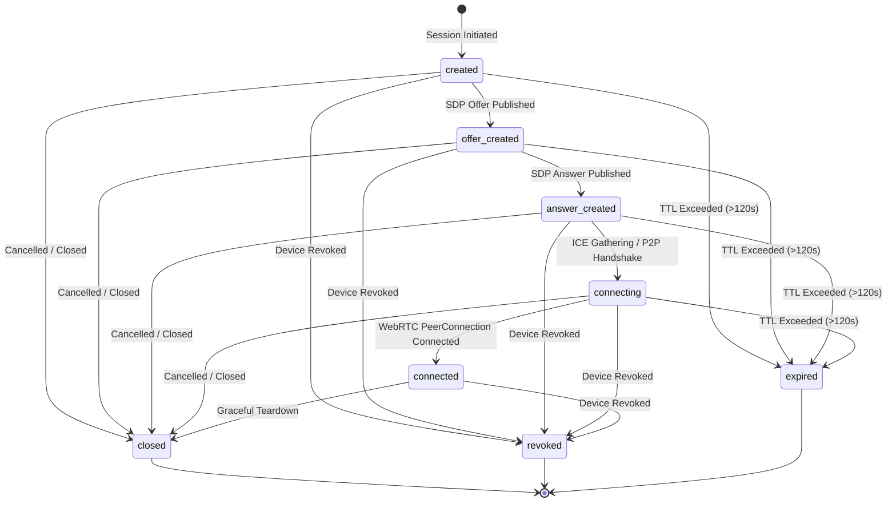

# VIRUX — Phase 4, Step 4.2 Implementation Assessment
# WebRTC Signaling Foundation & Secure Session Management

**Date:** 2026-11-08  
**Project:** VIRUX — Your Devices. One Ecosystem.  
**Package:** `com.virux.app` | **Project ID:** `virux-504a5` | **Plan:** Spark (Free Tier)  

---

## 1. Executive Summary & Verification Context

Prior to modifying any rules, test suites, or client source code, a comprehensive architectural inspection of the VIRUX repository was conducted:
1. `firebase/firestore.rules`: Reviewed current security boundary under `match /databases/{database}/documents`. Confirmed strict tenant isolation (`isOwner(userId)`), atomic pairing transactions (`match /pairingSessions/{sessionId}`), device lifecycle constraints (`match /devices/{deviceId}`), and catch-all default deny.
2. `shared/contracts/webrtc.schema.json`: Reviewed existing WebRTC session schema specification. Identified requirement to expand properties to accommodate strict session typing, lifecycle states, protocol versioning, and bounded candidate batching.
3. `shared/contracts/device.schema.json`: Reviewed registered device schema to ensure signaling paths preserve device ownership, device existence checks, and revocation state checks (`revokedAt == null`).
4. Android Architecture (`com.virux.app`):
   - Auth & Device Repositories: `AuthRepositoryImpl.kt` and `DeviceRepositoryImpl.kt` established clean coroutine-based Firebase abstractions.
   - Device Identifiers: Keystore-backed cryptographic keys and stable hardware identities.
   - Signaling Requirement: Native WebRTC `.aar` is not required for signaling; signaling strictly requires Firebase Firestore SDK and Kotlin Coroutines/Flows. MediaProjection and video capture are explicitly deferred to Step 4.3.
5. Web Dashboard Architecture (`web-dashboard`):
   - Modular Firebase v9+ SDK (`firebase/firestore`, `firebase/auth`).
   - Clean typed service pattern (`authService.ts`, `deviceService.ts`).
   - Signaling will be encapsulated in `signalingService.ts` and `types/signaling.ts`.

---

## 2. Firestore Signaling Architecture & Data Model

### 2.1 Collection Hierarchy
Signaling sessions are nested as a subcollection under the registered device document:
```
/users/{userId}/devices/{deviceId}/signaling/{sessionId}
  └── candidateBatches/{batchId}
```

**Benefits of this hierarchy:**
- **Automatic Multi-Tenant Isolation:** Inherits path-level `isOwner(userId)` validation.
- **Direct Device Coupling:** Path enforces that signaling sessions belong to a specific paired physical device (`deviceId`).
- **Clean Cascade & Teardown:** When a device is unpaired or hard-deleted, all signaling sessions and candidate subcollections remain strictly scoped under that path.
- **Revocation Enforcement:** Rules can verify parent device validity (`get(/.../devices/{deviceId}).data.revokedAt == null`) on every write.

### 2.2 Signaling Session Document Schema (`/signaling/{sessionId}`)
| Field | Type | Description | Mutability |
| :--- | :--- | :--- | :--- |
| `sessionId` | `string` | Unique session UUID | Immutable |
| `ownerUid` | `string` | User identifier (must equal `userId`) | Immutable |
| `deviceId` | `string` | Target device identifier (must equal `deviceId`) | Immutable |
| `initiator` | `string` | `'web'` \| `'android'` | Immutable |
| `sessionType` | `string` | `'screen_mirror'` \| `'file_transfer'` | Immutable |
| `status` | `string` | Lifecycle status enum | Mutable (strict transitions) |
| `protocolVersion` | `string` | Virux signaling protocol (`'1.0'`) | Immutable |
| `createdAt` | `Timestamp` | Creation timestamp (`request.time`) | Immutable |
| `updatedAt` | `Timestamp` | Last update timestamp (`request.time`) | Mutable |
| `expiresAt` | `Timestamp` | Hard TTL (server time + $\le 120$ s) | Immutable |
| `offer` | `map` (optional) | `{ type: 'offer', sdp: string }` ($\le 64$ KB) | Single-write |
| `answer` | `map` (optional) | `{ type: 'answer', sdp: string }` ($\le 64$ KB) | Single-write |

### 2.3 Candidate Batches Subcollection Schema (`/candidateBatches/{batchId}`)
| Field | Type | Description | Mutability |
| :--- | :--- | :--- | :--- |
| `batchId` | `string` | Unique batch UUID | Immutable |
| `sessionId` | `string` | Parent session UUID | Immutable |
| `sender` | `string` | `'web'` \| `'android'` | Immutable |
| `sequenceNumber`| `int` | Monotonic batch sequence number ($\ge 0$) | Immutable |
| `candidates` | `list<map>` | Array of ICE candidates ($\le 25$ items) | Immutable |
| `isComplete` | `bool` | True if candidate gathering has finished | Immutable |
| `createdAt` | `Timestamp` | Creation timestamp (`request.time`) | Immutable |

Candidate batch documents are **strictly append-only** (`allow update, delete: if false`).

---

## 3. Session Lifecycle State Machine & Transition Invariants

The signaling session follows an explicit forward-only state machine:



### Transition Invariants:
1. **Terminal State Immutability:** Once `status` becomes `'closed'`, `'revoked'`, or `'expired'`, no further updates to the session document or writes to the `candidateBatches` subcollection are permitted.
2. **TTL Enforcement in Security Rules:** All updates and candidate batch creations assert `request.time < resource.data.expiresAt` (or parent session `expiresAt`). Expired sessions are immediately rejected by rules without awaiting background cleanup jobs.
3. **Parent Revocation Enforcement:** Every session creation, session update, and candidate batch creation checks that the parent device is active:
   `get(/databases/$(database)/documents/users/$(userId)/devices/$(deviceId)).data.revokedAt == null`.

---

## 4. ICE Candidate Batching & Quota Protection Strategy

### 4.1 The Challenge
Standard trickle ICE emits individual candidates asynchronously as network interfaces are enumerated. Emitting 10–25 candidates per peer as individual Firestore document writes would consume 20–50 Firestore writes per session, rapidly depleting the Firebase Spark plan daily quota (20,000 writes/day).

### 4.2 The Solution: Debounced Batching
Both Web and Android clients buffer gathered ICE candidates into an in-memory queue:
- **Debounce Window:** 250 ms.
- **Maximum Batch Size:** 25 candidates.
- **Batch Document:** Written to `candidateBatches/{batchId}` with an incrementing `sequenceNumber`.
- **Deduplication:** An in-memory Set of candidate signatures (`${candidate}|${sdpMid}|${sdpMLineIndex}`) prevents duplicate submission.
- **Expected Document Writes:** Under standard dual-stack Wi-Fi conditions, candidate gathering completes in 1 to 2 batches per peer, keeping total session signaling writes under 6 to 8 writes.

---

## 5. Security & Isolation Controls

1. **Authentication & Tenant Isolation:** User must be authenticated (`request.auth != null`) and `request.auth.uid == userId`.
2. **Payload Size Bounds:** SDP strings are capped at 64 KB (65,536 characters), preventing Firestore document bloat or storage-exhaustion attacks. Candidate batches are capped at 25 entries per document.
3. **No TURN / External Relay Exposure:** STUN-only configuration using Google's public STUN server (`stun:stun.l.google.com:19302`). No third-party or paid credentials required.
4. **Listener Teardown:** Web and Android clients maintain strict listener handles (`ListenerRegistration` in Android, `Unsubscribe` callback in Web). When sessions transition to any terminal state or on component unmount, all Firestore listeners and debounce coroutines/timers are cleanly cancelled.

---

## 6. Verification Plan

1. **Firestore Security Rules Tests (`run-rules-tests.mjs`):**
   - Add Vector 8 covering 10+ new test cases for signaling session authorization, SDP offer/answer validation, ICE candidate batch validation, TTL enforcement, parent revocation blocking, and terminal state immutability.
   - Re-run all 31 existing test cases to guarantee 0 regressions.
2. **Android Unit Testing:**
   - Add `SignalingBatchingTest.kt` verifying candidate buffering, 250 ms debounce timing, deduplication, and state machine transition validation.
   - Execute `.\gradlew.bat clean testDebugUnitTest assembleDebug`.
3. **Web Dashboard Build:**
   - Execute `npm --prefix web-dashboard run build` to confirm 0 TypeScript or packaging errors.
4. **Documentation:**
   - Provide full implementation, security, and test reports.
   - Halt execution strictly at Step 4.2.

