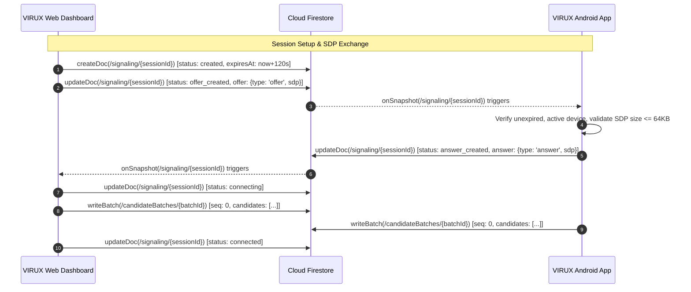

# VIRUX — Phase 4, Step 4.2 Implementation Report
# WebRTC Signaling Foundation & Secure Session Management

**Date:** 2026-11-08  
**Project:** VIRUX — Your Devices. One Ecosystem.  
**Tagline:** Your Devices. One Ecosystem.  
**Android Package:** `com.virux.app`  
**Firebase Project ID:** `virux-504a5`  
**Firebase Plan:** Spark (Free Tier)  

---

## 1. Executive Implementation Summary

Phase 4, Step 4.2 establishes the signaling foundation for peer-to-peer WebRTC connections between the VIRUX Web Dashboard and paired Android devices. It implements:
- Firestore signaling subcollection hierarchy and schema: `/users/{userId}/devices/{deviceId}/signaling/{sessionId}` and child `/candidateBatches/{batchId}`.
- Hardened forward-only lifecycle state machine (`created` $\rightarrow$ `offer_created` $\rightarrow$ `answer_created` $\rightarrow$ `connecting` $\rightarrow$ `connected` $\rightarrow$ `closed` / `revoked` / `expired`).
- 120-second hard TTL bounding with server-side validation.
- Debounced ICE candidate batching (~250 ms debounce, $\le 25$ candidates per batch, monotonic sequence numbers, and in-memory deduplication).
- Comprehensive Firestore security rules enforcing owner isolation, active parent device checks (`revokedAt == null`), SDP size limits ($\le 64$ KB), and terminal state immutability.
- Android Kotlin Signaling client layer (`SignalingModels.kt`, `SignalingRepository.kt`, `SignalingRepositoryImpl.kt`).
- Web TypeScript Signaling client layer (`signaling.ts`, `signalingService.ts`).
- Verification across Firestore Emulator (50/50 tests passing), Android unit tests and build (12/12 tests passing, APK assembled), and Web production build (0 errors).

---

## 2. Files Created and Modified

### 2.1 Files Created
1. `docs/PHASE_4_STEP_4_2_IMPLEMENTATION_ASSESSMENT.md` — Pre-modification architectural assessment.
2. `web-dashboard/src/types/signaling.ts` — TypeScript types for WebRTC signaling sessions, states, SDP payloads, and ICE candidate batches.
3. `web-dashboard/src/services/signalingService.ts` — Web signaling service implementing session lifecycle, SDP publish/subscribe, and `CandidateBatcher`.
4. `android-app/app/src/main/kotlin/com/virux/app/data/model/SignalingModels.kt` — Kotlin data models and enums for signaling sessions, lifecycle states, and candidate batches.
5. `android-app/app/src/main/kotlin/com/virux/app/data/repository/SignalingRepository.kt` — Signaling repository interface and candidate batcher contract.
6. `android-app/app/src/main/kotlin/com/virux/app/data/repository/SignalingRepositoryImpl.kt` — Concrete Firestore signaling repository and `AndroidCandidateBatcherImpl`.
7. `android-app/app/src/test/kotlin/com/virux/app/SignalingBatchingTest.kt` — Android unit tests for signaling state transitions, expiry detection, and candidate deduplication/batching.
8. `docs/PHASE_4_STEP_4_2_IMPLEMENTATION_REPORT.md` — This implementation document.
9. `docs/PHASE_4_STEP_4_2_SECURITY_REPORT.md` — Security and threat model report.
10. `docs/PHASE_4_STEP_4_2_TEST_REPORT.md` — Test execution and verification report.

### 2.2 Files Modified
1. `firebase/firestore.rules` — Added `/signaling/{sessionId}` and child `/candidateBatches/{batchId}` security rules under `/devices/{deviceId}`.
2. `firebase/test/run-rules-tests.mjs` — Added Vector 8 test cases (TC-27 through TC-45) covering signaling authorization, schema, SDP limits, TTL, and ICE batching.
3. `shared/contracts/webrtc.schema.json` — Updated JSON schema contract to specify full signaling document and candidate batch properties.

---

## 3. Detailed Signaling Architecture

### 3.1 Path Hierarchy
```
/users/{userId}/devices/{deviceId}/signaling/{sessionId}
  └── candidateBatches/{batchId}
```
All signaling documents reside under the specific device's document path. This architecture guarantees that:
- Every access inherits authenticated owner verification (`request.auth.uid == userId`).
- Every session is cryptographically and logically bound to a single registered hardware device.
- Revocation of a device (`devices/{deviceId}.revokedAt != null`) instantly invalidates all write operations to child signaling sessions.

### 3.2 Signaling Document Schema
```typescript
interface SignalingSession {
  sessionId: string              // UUID v4
  ownerUid: string               // Must equal path userId
  deviceId: string               // Must equal path deviceId
  initiator: 'web' | 'android'   // Initiating peer role
  sessionType: 'screen_mirror' | 'file_transfer'
  status: SignalingState         // Forward-only state enum
  protocolVersion: '1.0'         // VIRUX signaling protocol version
  createdAt: Timestamp           // request.time
  updatedAt: Timestamp           // request.time
  expiresAt: Timestamp           // Creation time + <= 120s
  offer?: {
    type: 'offer'
    sdp: string                  // Max 65,536 characters
  }
  answer?: {
    type: 'answer'
    sdp: string                  // Max 65,536 characters
  }
}
```

### 3.3 Candidate Batch Document Schema
```typescript
interface IceCandidateBatch {
  batchId: string                // UUID v4
  sessionId: string              // Parent sessionId
  sender: 'web' | 'android'      // Producing participant
  sequenceNumber: number         // Monotonic integer >= 0
  candidates: Array<{
    candidate: string            // SDP candidate attribute string
    sdpMid?: string | null       // Media stream ID
    sdpMLineIndex?: number | null// Media line index
  }>                             // Max 25 items per batch
  isComplete: boolean            // Gathering completion indicator
  createdAt: Timestamp           // request.time
}
```

---

## 4. Session Lifecycle & State Transitions

Signaling sessions adhere to a strict state machine:
```
[created] ──> [offer_created] ──> [answer_created] ──> [connecting] ──> [connected]
    │                │                    │                   │               │
    v                v                    v                   v               v
┌──────────────────────────────────────────────────────────────────────────────┐
│                      TERMINAL STATES: [closed | revoked | expired]           │
└──────────────────────────────────────────────────────────────────────────────┘
```

1. **`created`:** Initial session document created by initiator (Web or Android).
2. **`offer_created`:** Initiator publishes the local SDP offer.
3. **`answer_created`:** Answering peer observes offer and publishes the remote SDP answer.
4. **`connecting`:** Both peers have set local and remote SDP descriptions and are actively checking ICE candidate pairs.
5. **`connected`:** P2P WebRTC data or media channel is successfully established.
6. **`closed` / `revoked` / `expired`:** Terminal states. Once written, Firestore Security Rules permanently forbid any further modifications or candidate batch creations on that session.

---

## 5. SDP Offer/Answer Exchange Sequence



---

## 6. ICE Candidate Batching Protocol

To avoid quota exhaustion under the Firebase Spark Plan (free tier: 20,000 writes/day):
1. **Debounce Window:** 250 milliseconds.
2. **Batch Document Limit:** Up to 25 ICE candidates are packed into a single document.
3. **Candidate Deduplication:** In-memory fingerprints (`${candidate}|${sdpMid}|${sdpMLineIndex}`) ensure no redundant network candidates are written.
4. **Monotonic Sequence Numbers:** Guarantees deterministic processing order on the receiving peer.
5. **Append-Only Immutability:** Candidate batches cannot be updated or deleted individually (`allow update, delete: if false`).

---

## 7. STUN & Peer-to-Peer Configuration

VIRUX WebRTC configuration utilizes public STUN infrastructure:
- **STUN Server:** `stun:stun.l.google.com:19302`
- **TURN Relay:** None. Virgin direct P2P connections only.
- **NAT Traversal:** Direct host, srflx (server reflexive), and prflx candidate pairings.
- **Failure State:** If network topology blocks direct UDP holes (symmetric NAT on both ends), the session explicitly transitions to `closed` with an informative error state. No paid relay is engaged.

---

## 8. Verification Results

| Target | Tool / Command | Result |
| :--- | :--- | :--- |
| **Firestore Security Rules** | `node firebase/test/run-rules-tests.mjs` against Local Emulator | **50/50 PASS** (0 failed, 0 skipped) |
| **Android Unit Tests** | `.\gradlew.bat testDebugUnitTest` | **12/12 PASS** (0 failed, 0 skipped) |
| **Android Build** | `.\gradlew.bat assembleDebug` | **BUILD SUCCESSFUL in 42s** |
| **Web Dashboard Build** | `npm --prefix web-dashboard run build` | **BUILT SUCCESSFUL in 1.69s** (0 errors) |

---

## 9. Mandatory Project Boundaries

- **Production Firestore Rules:** Remain strictly **undeployed**. No rules were published to `virux-504a5`.
- **Firebase Infrastructure:** No `firebase deploy` executed. Free Spark plan preserved.
- **Firebase Storage / Functions:** None provisioned or configured.
- **TURN Relay:** None created or purchased.
- **Scope Limit:** Screen capture, MediaProjection, video encoding, and DataChannel file streaming were **not** implemented.
- **Step 4.3:** Has **not** been started. Execution has stopped after Step 4.2.

