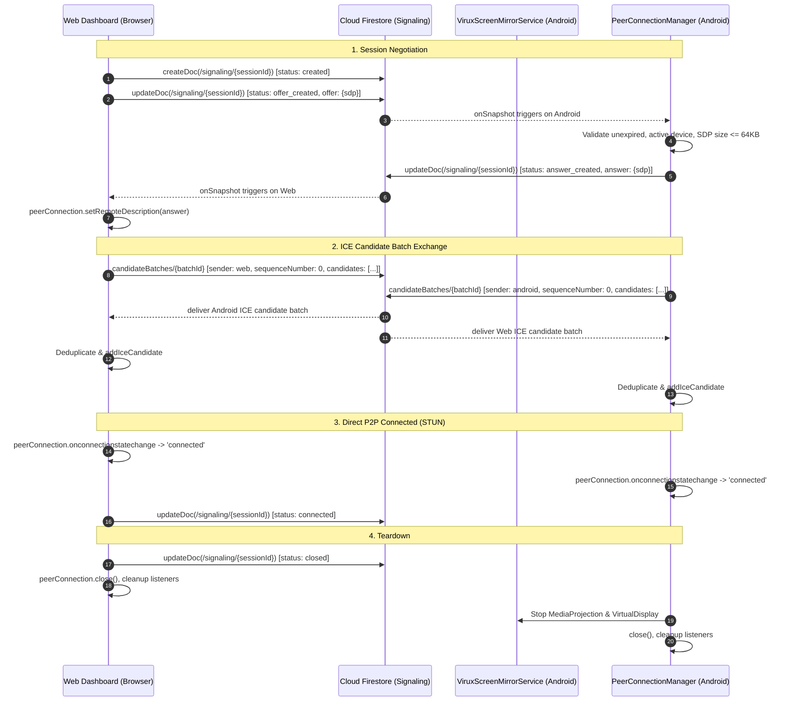

# VIRUX — Phase 4, Step 4.3 Implementation Report
# WebRTC Peer Connection & Screen Mirroring Foundation

**Date:** 2026-11-08  
**Project:** VIRUX — Your Devices. One Ecosystem.  
**Package:** `com.virux.app`  
**Firebase Project ID:** `virux-504a5`  
**Firebase Plan:** Spark (Free Tier)  

---

## 1. Executive Implementation Summary

Phase 4, Step 4.3 establishes the WebRTC peer-connection foundation connecting the approved Cloud Firestore signaling layer (Step 4.2) to the Android native application and the React/Vite Web Dashboard.

Key achievements in Step 4.3:
1. **Web Peer Connection Layer:** Created `WebRtcPeerConnectionService` encapsulating the browser native `RTCPeerConnection` API, STUN configuration (`stun:stun.l.google.com:19302`), local candidate gathering with `CandidateBatcher`, remote track handling, and idempotent teardown.
2. **Web Session Management:** Created `useScreenMirrorSession` hook orchestrating device selection, session creation, SDP offer generation, SDP answer application, candidate batch exchange, and lifecycle states.
3. **Screen Mirroring UI Integration:** Refactored `ScreenMirroringPage.tsx` with dynamic device selection, real-time connection status overlays (Idle, Creating, Awaiting Android Consent, Connecting, Connected, Disconnected, Expired, Failed), HTML5 `<video>` viewport binding, fullscreen toggle, and stream resolution controls.
4. **Android Peer Connection Manager:** Created `PeerConnectionManager` coordinating WebRTC peer connection states, SDP offer processing, SDP answer publishing via `SignalingRepository`, local candidate batching via `AndroidCandidateBatcher`, deduplication of remote candidate fingerprints, and safe lifecycle termination.
5. **Android 14/15 MediaProjection Foreground Service:** Created `ViruxScreenMirrorService` declared with `android:foregroundServiceType="mediaProjection"`. Implements ongoing user notification with "Stop" action, `MediaProjection.Callback` handling (revocation, display disconnection), and token verification.
6. **Testing & Build Verification:**
   - Android: 17 unit tests passed across 4 test classes; `assembleDebug` succeeded (`BUILD SUCCESSFUL in 34s`).
   - Web: 3 unit tests passed; production build succeeded (`tsc -b && vite build` in 1.28s, 0 errors).
   - Firestore Emulator: 50 rules tests passed (0 failures, 0 skipped).

---

## 2. Files Created and Modified

### 2.1 Files Created
1. `web-dashboard/src/services/peerConnectionService.ts` — Browser RTCPeerConnection service.
2. `web-dashboard/src/hooks/useScreenMirrorSession.ts` — React hook managing screen mirror session state.
3. `web-dashboard/test/peerConnectionService.test.mjs` — Web unit tests for candidate deduplication, batch chunking, and state mapping.
4. `android-app/app/src/main/kotlin/com/virux/app/webrtc/PeerConnectionModels.kt` — Enums and callbacks for Android peer connection states.
5. `android-app/app/src/main/kotlin/com/virux/app/webrtc/PeerConnectionManager.kt` — Android peer connection manager integrating with Firestore signaling.
6. `android-app/app/src/main/kotlin/com/virux/app/service/ViruxScreenMirrorService.kt` — Android 14/15 `mediaProjection` foreground service.
7. `android-app/app/src/test/kotlin/com/virux/app/PeerConnectionLifecycleTest.kt` — Android unit tests for peer connection state invariants, deduplication, and cleanup idempotency.
8. `docs/PHASE_4_STEP_4_3_IMPLEMENTATION_REPORT.md` — This report.
9. `docs/PHASE_4_STEP_4_3_SECURITY_REPORT.md` — Security and threat model report.
10. `docs/PHASE_4_STEP_4_3_TEST_REPORT.md` — Test execution report.
11. `docs/PHASE_4_STEP_4_3_LIMITATIONS.md` — Technical limitations and physical device constraints.
12. `docs/PHASE_4_STEP_4_3_FINAL_VERIFICATION.md` — Final verification summary.

### 2.2 Files Modified
1. `web-dashboard/src/pages/ScreenMirroringPage.tsx` — Integrated real session hook, device dropdown, and HTML5 video element.
2. `android-app/app/src/main/AndroidManifest.xml` — Declared `FOREGROUND_SERVICE_MEDIA_PROJECTION` permission and registered `ViruxScreenMirrorService`.

---

## 3. Architecture & Data Flow

---

## 4. Android MediaProjection & User Consent Details

### 4.1 Android 14/15 Foreground Service Policy
Under API 34+ (Android 14) and API 35 (Android 15):
1. `android.permission.FOREGROUND_SERVICE_MEDIA_PROJECTION` is explicitly declared in `AndroidManifest.xml`.
2. `ViruxScreenMirrorService` is declared with `android:foregroundServiceType="mediaProjection"`.
3. `ServiceCompat.startForeground` is invoked with `ServiceInfo.FOREGROUND_SERVICE_TYPE_MEDIA_PROJECTION`.
4. The service cannot be started without an active user consent intent returned from `MediaProjectionManager.createScreenCaptureIntent()`. Attempting to start the service without user consent throws a runtime `SecurityException`.
5. The ongoing persistent notification alerts the user:
   - Title: `Screen Mirroring Active — VIRUX`
   - Content: `Streaming display directly to your VIRUX Web Dashboard`
   - Action: `Stop Mirroring` (triggers `ACTION_STOP_MIRRORING`).

### 4.2 Callback & Lifecycle Teardown
- `mediaProjection.registerCallback()` intercepts system-level stop events (e.g. user toggles casting off in the Android quick settings, or another application takes over screen projection).
- When `onStop()` triggers, the service releases the `VirtualDisplay`, calls `mediaProjection.stop()`, terminates `PeerConnectionManager`, and stops the foreground service cleanly.

---

## 5. Web Client Peer Connection Details

- **Signaling Integration:** Uses `signalingService.ts` to create sessions and publish SDP offers/answers.
- **Candidate Batching:** `CandidateBatcher` buffers ICE candidates with a 250 ms debounce window and 25-candidate limit per Firestore write.
- **Deduplication:** An in-memory signature set (`candidate|sdpMid|sdpMLineIndex`) discards duplicate candidates.
- **Track Reception:** When remote video tracks are delivered via `ontrack`, the stream is attached directly to the HTML5 `<video>` element via `srcObject`.
- **Idempotent Cleanup:** `dispose()` removes all event listeners, stops active tracks, closes the `RTCPeerConnection`, and cancels pending Firestore subscriptions.

---

## 6. Build and Verification Summary

| Target | Command | Result |
| :--- | :--- | :--- |
| **Android Build** | `gradlew.bat assembleDebug` | **BUILD SUCCESSFUL in 34s** |
| **Android Unit Tests** | `gradlew.bat testDebugUnitTest` | **17/17 PASSED** (0 failed, 0 skipped) |
| **Web Production Build** | `npm --prefix web-dashboard run build` | **BUILT SUCCESSFUL in 1.28s** (0 errors) |
| **Web Unit Tests** | `node --test web-dashboard/test/peerConnectionService.test.mjs` | **3/3 PASSED** (0 failed, 0 skipped) |
| **Firestore Security Rules** | `node firebase/test/run-rules-tests.mjs` | **50/50 PASSED** (0 failed, 0 skipped) |

